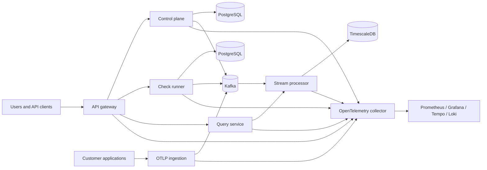
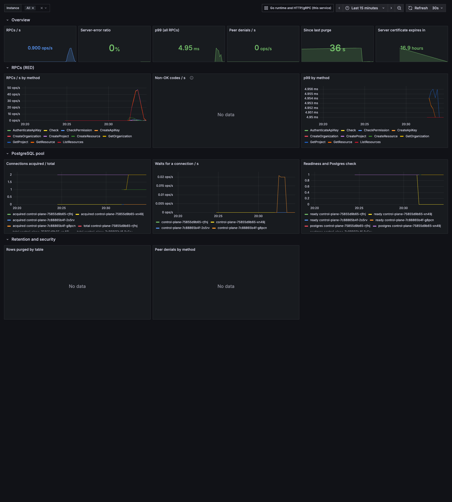
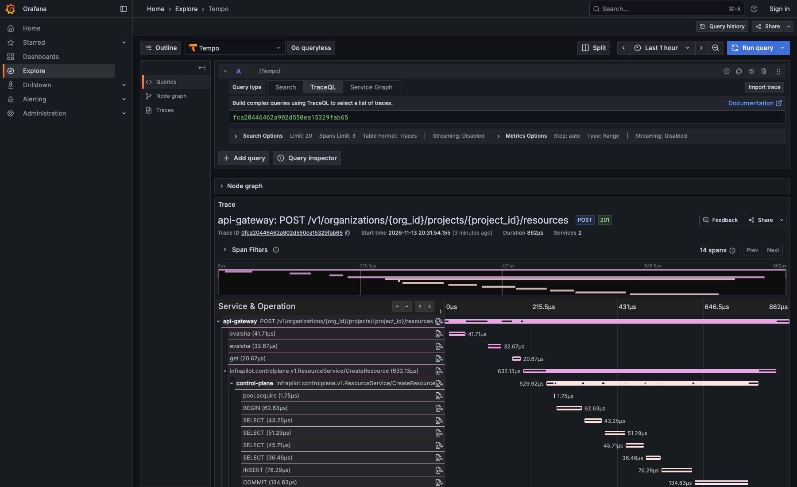

# InfraPilot

**Infrastructure monitoring and incident operations for multi-tenant teams.** InfraPilot combines resource inventory, authenticated telemetry ingestion, scheduled checks, and operational visibility. Its roadmap extends the pipeline into incident response, notifications, agents, workflows, and investigation.

> **Status:** M01 (engineering platform) and M02 (identity, control plane, API gateway) are complete. M03 (checks and telemetry pipeline) is in progress. M03 source and contracts are present, but deployment and full acceptance gates remain open. See the [roadmap](docs/roadmap.md).

## What is available

| Area | Implementation |
| --- | --- |
| Identity and tenancy | Keycloak realm as code; organizations, projects, memberships, role-based permissions, project API keys, and PostgreSQL row-level security. |
| Public API | OpenAPI-generated REST gateway with JWT and API-key authentication, Redis-backed rate limiting, idempotency keys, and problem responses. |
| Service security | Workload certificates, mTLS, SPIFFE identities, and per-RPC peer policies. |
| Operations | Helm library chart, kind deployment, health endpoints, OpenTelemetry instrumentation, Grafana dashboards, Prometheus alerts, and runbooks. |
| M03 in progress | Check definitions and probes, Kafka-backed events, OTLP metrics ingestion, TimescaleDB storage, and bounded read services. These paths are still undergoing end-to-end verification. |

## Architecture



Each service owns its data. Public traffic enters through the gateway; internal calls use gRPC with deadlines. Kafka carries events, while database changes and publications use transactional outboxes. Tenant data is scoped through row-level security. The [architecture overview](docs/architecture/overview.md), [data design](docs/architecture/data.md), and [security design](docs/architecture/security.md) document these boundaries.

## Observability in practice

These screenshots were captured from the M02 kind deployment during load verification. They document the completed M02 services; M03 is still in progress.

### API gateway


### Control plane



### Cross-service trace



The [dashboard definitions](observability/grafana/dashboards), [alert rules](observability/prometheus/rules), and [runbooks](docs/runbooks) are maintained alongside the services.

## Technology

The current services use Go, REST/OpenAPI, gRPC/Protobuf, PostgreSQL, Redis, Kafka, TimescaleDB, Kubernetes/Helm, and OpenTelemetry. The accepted architecture plans RabbitMQ, ClickHouse, Python/FastAPI, object storage, and a Next.js dashboard for later milestones. Planned components are tracked in the [roadmap](docs/roadmap.md).

## Run and verify locally

Docker Desktop with at least 8 GB of memory, Go, `kubectl`, and Homebrew on macOS are required. Bootstrap installs the pinned project tools.

```bash
make bootstrap
make verify
make up PROFILE=core,obs
make cluster deploy e2e
```

For the completed M02 services on kind:

```bash
make kind-platform kind-deps
make deploy-services
make e2e-services load-smoke
```

`make verify` runs formatting, lint, contract checks, race-enabled Go tests, and Docker-backed integration tests. The kind targets exercise deployed services. M03 end-to-end, load, and failure gates remain open.

## Documentation

| Document | Purpose |
| --- | --- |
| [Architecture overview](docs/architecture/overview.md) | Services, communication, SLOs, and capacity target |
| [Data and messaging](docs/architecture/data.md) | Ownership, topics, queues, retention, and delivery guarantees |
| [Security](docs/architecture/security.md) | Identity, authorization, SSRF controls, and threat model |
| [Failure scenarios](docs/architecture/failure-scenarios.md) | Failure modes and automated proof targets |
| [Architecture decisions](docs/adr/README.md) | Accepted design choices and trade-offs |
| [Roadmap](docs/roadmap.md) | Milestone scope, status, and acceptance criteria |
