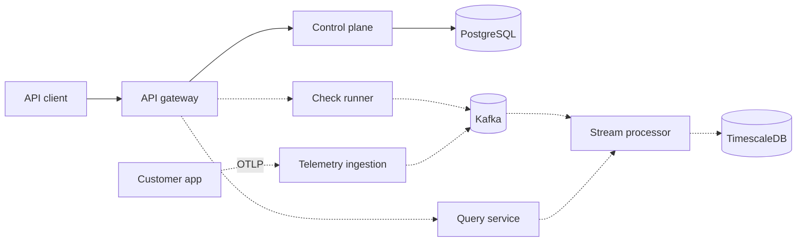
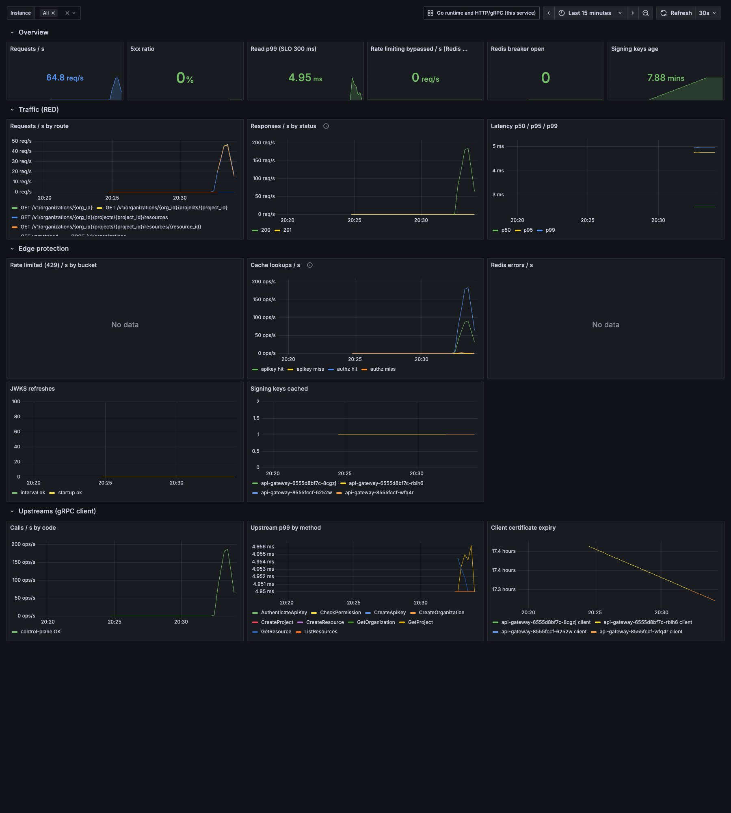

# InfraPilot

[English](README.md) · [Русский](README.ru.md)

InfraPilot is an infrastructure monitoring platform for teams that manage multiple organizations and projects. It provides a secure place to organize resources, control access, expose an API, and observe how its services behave. The repository also contains the developing checks and telemetry pipeline.

## What you can use

- **Resource inventory:** create organizations and projects, manage members and roles, and register resources through the public API.
- **Access control:** authenticate with Keycloak or project API keys. The gateway enforces request limits; PostgreSQL row-level security isolates organization data.
- **Operational visibility:** inspect health endpoints, metrics, alerts, logs, and distributed traces. Helm charts and a local kind setup support deployment checks.

Check scheduling, OTLP metrics ingestion, Kafka processing, TimescaleDB storage, and query endpoints have source code in this repository. Their end-to-end deployment and acceptance checks are still being completed. Incident response, notifications, host agents, workflows, and the dashboard are planned in the [roadmap](docs/roadmap.md).

## How the system fits together

The API gateway accepts public REST requests and forwards authorized operations to internal gRPC services. The control plane owns organizations, projects, permissions, API keys, and resources in PostgreSQL. Each data-owning service has its own database. Kafka carries events between the check, ingestion, and processing services; TimescaleDB stores time-series data. OpenTelemetry connects service metrics and traces to the observability stack.



Solid lines show the established API and control-plane path. Dotted lines show the pipeline under integration. Read the [architecture overview](docs/architecture/overview.md), [data model](docs/architecture/data.md), and [security design](docs/architecture/security.md) for details.

## Screenshots

These are real captures from a local kind deployment of the gateway and control plane. They show historical verification output, rather than a live hosted instance.

**Gateway traffic and protection**



**Control-plane health and RPCs**


**A request across services**


The [Grafana dashboards](observability/grafana/dashboards), [Prometheus rules](observability/prometheus/rules), and [runbooks](docs/runbooks) are versioned with the code.

## Run locally

You need Docker Desktop with at least 8 GB of memory, Go, `kubectl`, and Homebrew on macOS. From the repository root:

```bash
make bootstrap                # install pinned development tools
make up PROFILE=core,obs      # start PostgreSQL, Redis, Keycloak, and observability
make cluster                  # create the local kind cluster
make kind-platform kind-deps  # install cluster certificates and dependencies
make deploy-services          # deploy the control plane and API gateway
```

Run `make verify` for lint, contract checks, race-enabled Go tests, and Docker-backed integration tests. Run `make e2e-services` for the deployed gateway and control-plane path. The [Makefile](Makefile) lists all targets.

## Documentation

| Guide | Contents |
| --- | --- |
| [Architecture](docs/architecture/overview.md) | Services, communication, and capacity goals |
| [Data and messaging](docs/architecture/data.md) | Ownership, events, retention, and delivery guarantees |
| [Security](docs/architecture/security.md) | Identities, authorization, and threat model |
| [Failure scenarios](docs/architecture/failure-scenarios.md) | Expected behavior during outages |
| [Decisions](docs/adr/README.md) | Accepted design choices |
| [Roadmap](docs/roadmap.md) | Scope and acceptance criteria |
