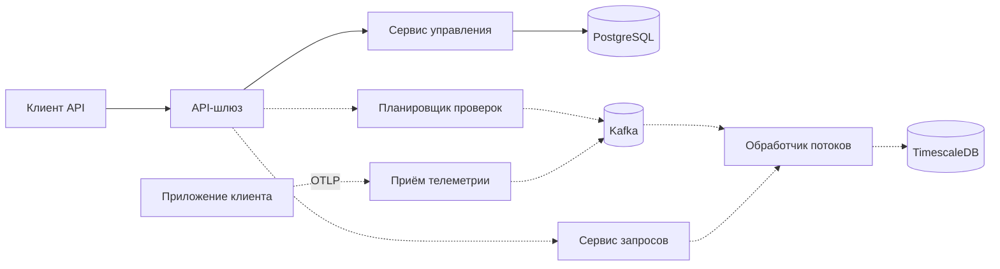
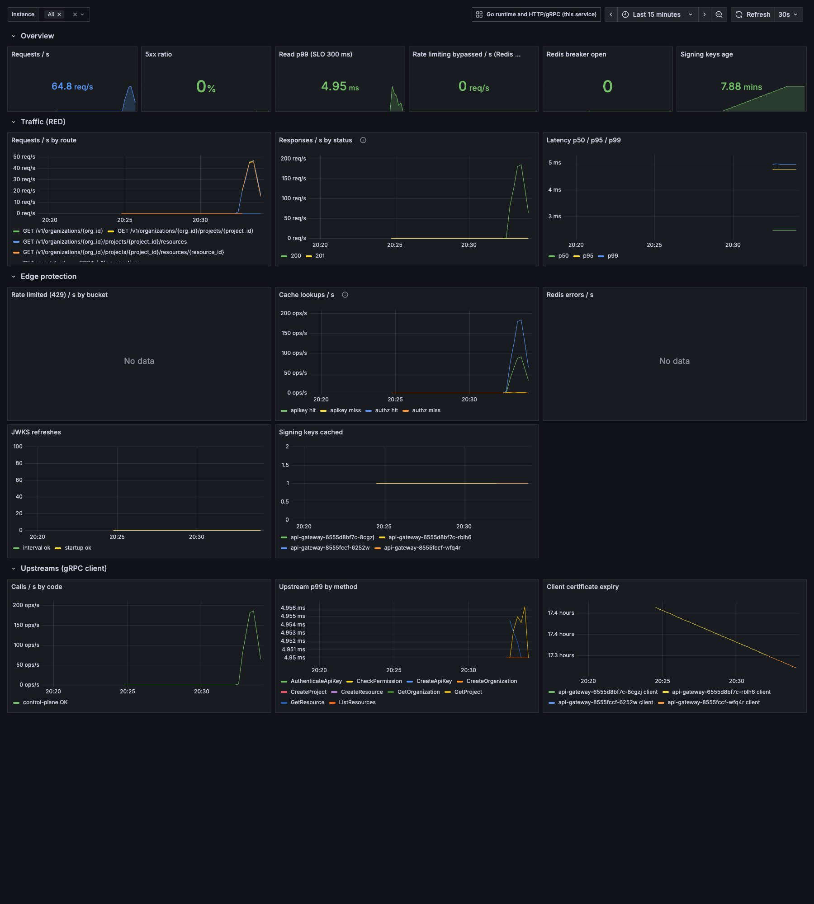
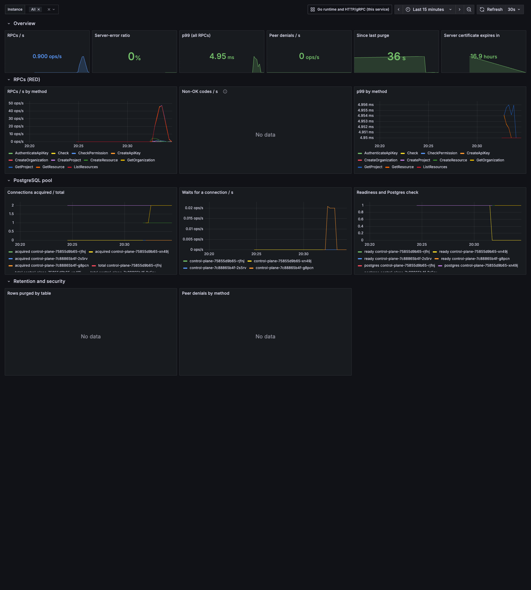
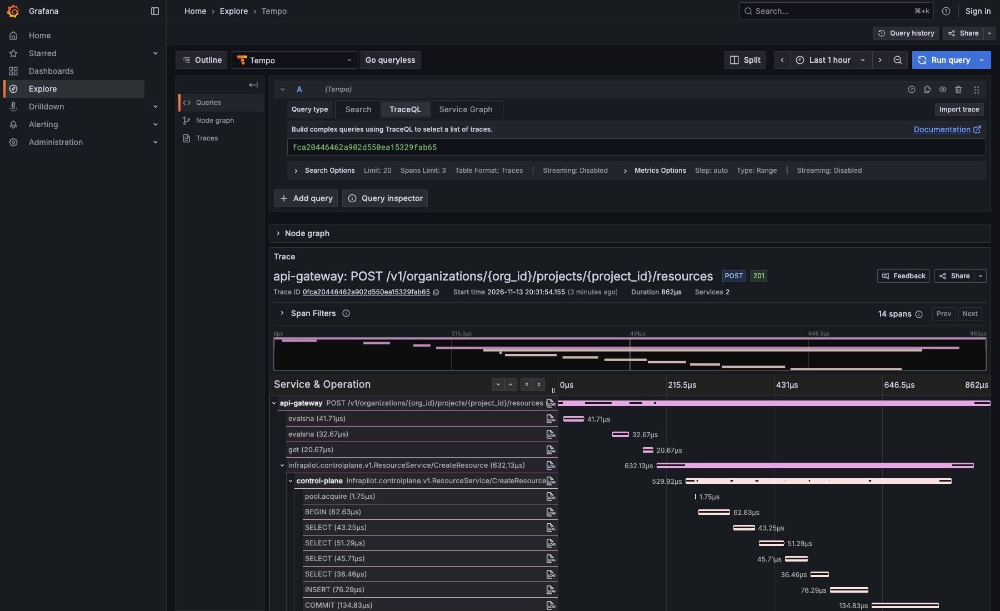

# InfraPilot

[English](README.md) · [Русский](README.ru.md)

InfraPilot — платформа мониторинга инфраструктуры для команд, работающих с несколькими организациями и проектами. Она помогает вести реестр ресурсов, управлять доступом, работать через API и наблюдать за состоянием собственных сервисов. В репозитории также находится разрабатываемый конвейер проверок и телеметрии.

## Что уже можно использовать

- **Реестр ресурсов:** создание организаций и проектов, управление участниками и ролями, регистрация ресурсов через публичный API.
- **Контроль доступа:** аутентификация через Keycloak или API-ключи проектов. Шлюз ограничивает частоту запросов, а PostgreSQL Row-Level Security изолирует данные организаций.
- **Наблюдаемость:** проверки состояния сервисов, метрики, оповещения, логи и распределённые трассировки. Helm-чарты и локальный кластер kind позволяют проверять развёртывание.

Исходный код планировщика проверок, приёма метрик OTLP, обработки событий Kafka, хранения рядов в TimescaleDB и API запросов уже находится в репозитории. Сквозное развёртывание и приёмочные проверки этих компонентов ещё не завершены. Управление инцидентами, уведомления, хостовые агенты, автоматизация и веб-интерфейс описаны в [плане развития](docs/roadmap.md).

## Как устроена система

API-шлюз принимает публичные REST-запросы и передаёт разрешённые операции внутренним сервисам по gRPC. Сервис управления хранит организации, проекты, права, API-ключи и ресурсы в PostgreSQL. Каждый сервис, владеющий данными, использует собственную базу. Kafka передаёт события между сервисами проверок, приёма и обработки телеметрии; TimescaleDB хранит временные ряды. OpenTelemetry связывает метрики и трассировки сервисов со стеком наблюдаемости.



Сплошные линии показывают уже проверенный путь API и сервиса управления. Пунктирные линии обозначают конвейер, интеграция которого продолжается. Подробности приведены в [обзоре архитектуры](docs/architecture/overview.md), [описании данных](docs/architecture/data.md) и [модели безопасности](docs/architecture/security.md).

## Скриншоты

Это реальные снимки локального развёртывания API-шлюза и сервиса управления в kind. Они показывают результаты ранее проведённой проверки, а не работающий публичный экземпляр.

**Трафик и защита API-шлюза**



**Состояние сервиса управления и вызовы RPC**



**Запрос, проходящий через несколько сервисов**



[Панели Grafana](observability/grafana/dashboards), [правила Prometheus](observability/prometheus/rules) и [инструкции по эксплуатации](docs/runbooks) хранятся вместе с кодом.

## Локальный запуск

Понадобятся Docker Desktop с объёмом памяти не менее 8 ГБ, Go, `kubectl` и Homebrew на macOS. Из корня репозитория выполните:

```bash
make bootstrap                # установить закреплённые версии инструментов
make up PROFILE=core,obs      # запустить PostgreSQL, Redis, Keycloak и стек наблюдаемости
make cluster                  # создать локальный кластер kind
make kind-platform kind-deps  # установить сертификаты и зависимости в кластер
make deploy-services          # развернуть сервис управления и API-шлюз
```

Команда `make verify` запускает линтеры, проверку контрактов, Go-тесты с детектором гонок и интеграционные тесты с реальными зависимостями в Docker. `make e2e-services` проверяет развёрнутые API-шлюз и сервис управления. Полный список команд находится в [Makefile](Makefile).

## Документация

| Раздел | Содержание |
| --- | --- |
| [Архитектура](docs/architecture/overview.md) | Сервисы, взаимодействие и целевая нагрузка |
| [Данные и обмен сообщениями](docs/architecture/data.md) | Владение данными, события, сроки хранения и гарантии доставки |
| [Безопасность](docs/architecture/security.md) | Идентификация, авторизация и модель угроз |
| [Сценарии отказов](docs/architecture/failure-scenarios.md) | Ожидаемое поведение при сбоях |
| [Архитектурные решения](docs/adr/README.md) | Принятые решения и их обоснование |
| [План развития](docs/roadmap.md) | Объём работ и критерии приёмки |
